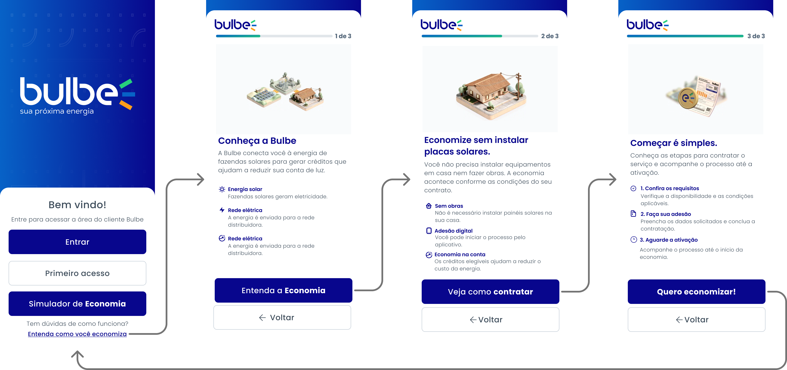
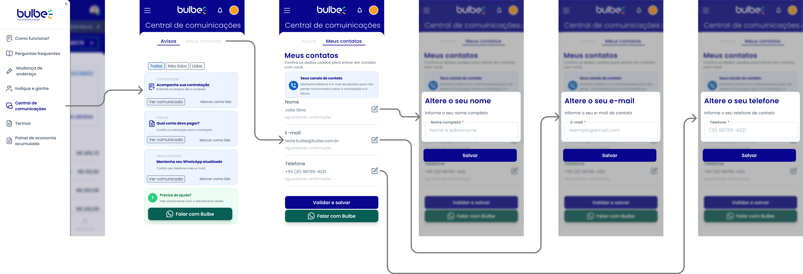
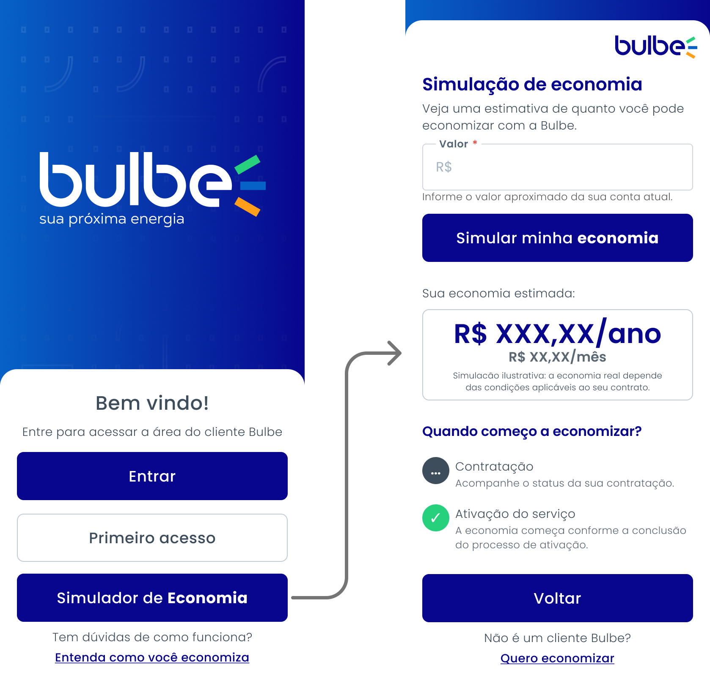
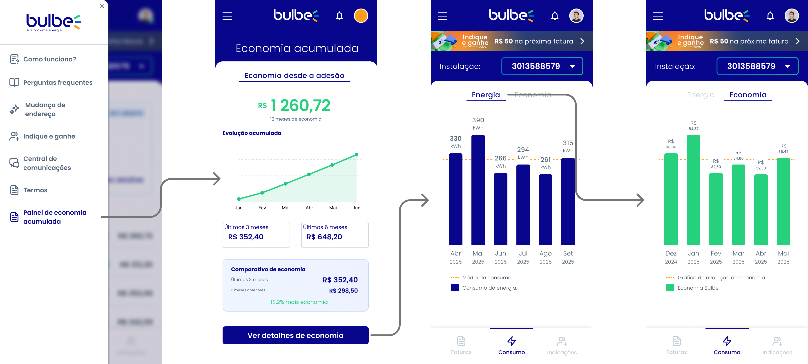

# Wireframes

Guardem aqui as imagens exportadas dos wireframes (PNG ou JPG), uma por tela, e também a imagem do mapa de jornada (`jornada.png`).

Nomeie os arquivos de tela com o ID da história: `hu01-confirmar-contatos.png`.

# Wireframes — Projeto Bulbe Energia

Esta pasta reúne os wireframes das quatro histórias de usuário
definidas para o MVP do projeto Bulbe Energia.

Os wireframes representam as telas planejadas para a Sprint II,
com foco na melhoria da experiência dos clientes.

---

## HU01 — Onboarding educativo

Tela destinada a explicar o funcionamento da Bulbe Energia
antes da contratação e orientar o cliente sobre o período
entre a adesão e o início da economia.

---

## HU02 — Central de comunicações

Tela que permite consultar comunicados importantes da Bulbe,
identificar mensagens não lidas e confirmar os dados de contato.

---

## HU03 — Simulador de economia

Tela que permite estimar a economia na conta de energia
e compreender o início dos benefícios após a contratação.

---

## HU04 — Painel de economia acumulada

Tela que apresenta o total economizado desde a adesão,
a evolução acumulada e a comparação entre períodos.

